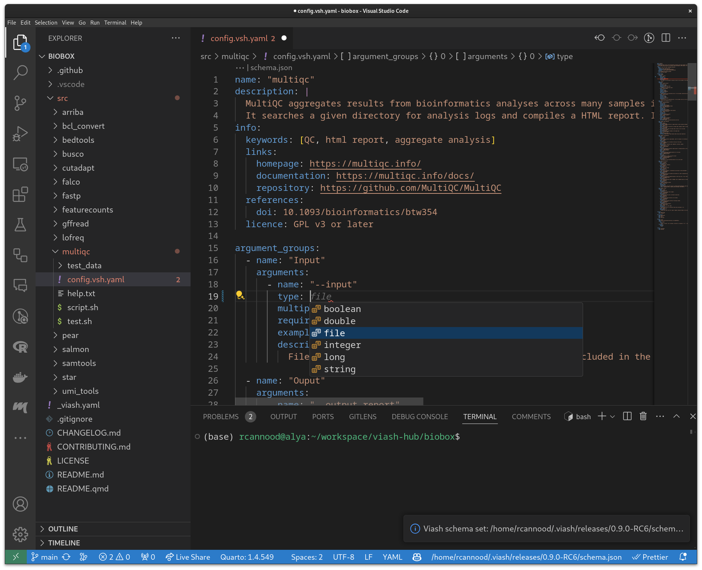

# viash-vscode

This extension provides language support for Viash components (`*.vsh.yaml`).



## Features

* Syntax highlighting and validation for Viash components (`*.vsh.yaml`).
* Support for validating Viash project config at `_viash.yaml`.
* Support for unit testing Viash components.

## Installation

Install the extension from the [Visual Studio Code Marketplace](https://marketplace.visualstudio.com/items?itemName=data-intuitive.viash).

## Requirements

Install Viash using [these instructions](https://viash.io/installation).

## Viash Lint

If Viash Lint (`vlint`) is installed, the extension starts its language server for YAML files.

> [!NOTE]
> Viash Lint is not currently publicly available.
> These features are only available if you have access to install `vlint`.

The extension uses `vlint` on the `PATH`.
To use a different binary, set `viash.vlint.path`.
To turn off Viash Lint, set `viash.vlint.enable` to `false`.
The "Viash Lint" output panel shows the server log.
To also see the LSP messages, set the log level of "Viash Lint" to Trace with **Developer: Set Log Level...**.
Set `viash.vlint.trace.server` to `verbose` to include the message payloads.

To fix all safe problems on save, add this to your settings:

```json
"editor.codeActionsOnSave": { "source.fixAll.vlint": "explicit" }
```

### Formatting

Viash Lint is registered as a formatter for all YAML files, but the tool itself only formats Viash config files.
You can select Viash Lint as the default formatter for YAML files when prompted (or set `"[yaml]": { "editor.defaultFormatter": "data-intuitive.viash" }`) but then other YAML files will not be formatted.
Alternatively, use `> Format document with...` in the command palette to specifically format a file with Viash Lint.

## Contributing

Contributions are welcome! Please see the [Contributing Guidelines](CONTRIBUTING.md) for more information.

## Changelog

See [CHANGELOG.md](CHANGELOG.md) for a list of changes.

## License

This project is licensed under the GPL-3.0 License - see the [LICENSE.md](LICENSE.md) file for details.
